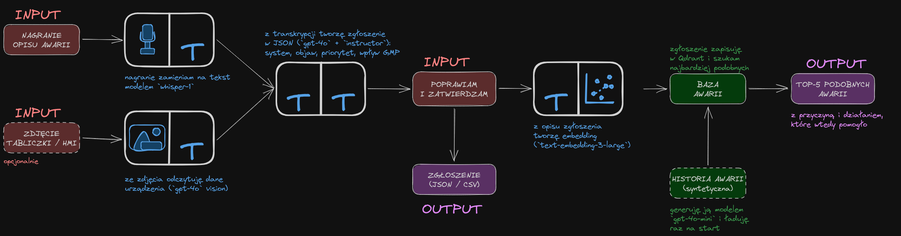
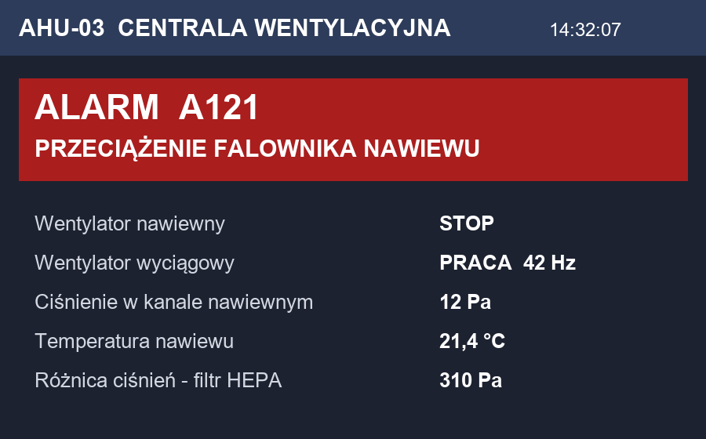
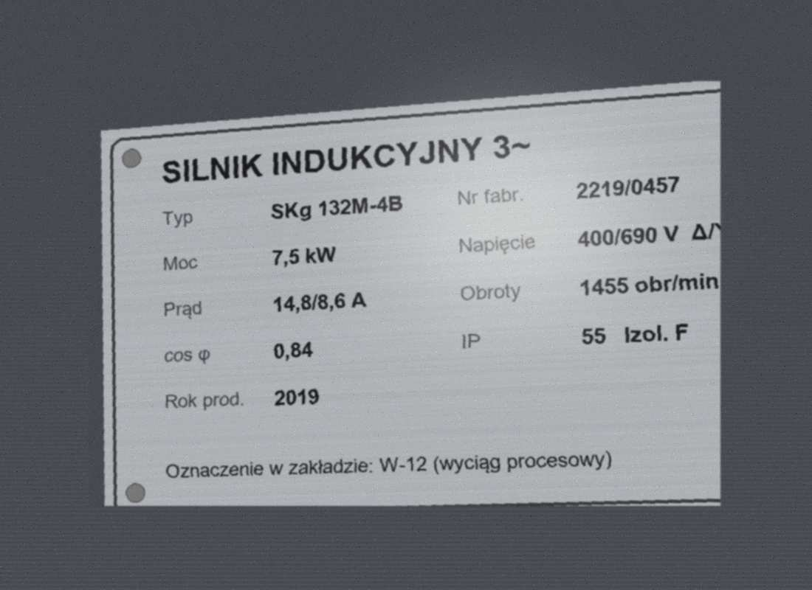

# Głosowe zgłaszanie awarii

**Projekt własny z kursu „Od zera do AI” (moduł 8)** ·
[:fontawesome-brands-github: kod na GitHubie](https://github.com/Jerry-S-77/glosowe-zglaszanie-awarii)

:material-calendar: **Powstał:** 13–24 października 2026 (specyfikacja, potem 9 kolejnych wersji aplikacji)

## Problem

Pracownicy utrzymania ruchu przy awarii mają zajęte ręce, pracują w hałasie i w rękawicach. Formularz
zgłoszenia wypełniają później, z pamięci i skrótowo. A najcenniejsza informacja – jak podobną awarię
naprawiono poprzednio – leży w historii, której nikt nie przeszukuje.

## Rozwiązanie

Technik nagrywa krótki opis awarii (opcjonalnie robi zdjęcie tabliczki znamionowej albo ekranu HMI).
Aplikacja zamienia to na uporządkowane zgłoszenie, a po zatwierdzeniu pokazuje 5 najbardziej podobnych
awarii z historii – z przyczyną, tym, co pomogło, i czasem przestoju.

1. **Transkrypcja** – `whisper-1` zamienia nagranie na tekst, który mogę poprawić.
2. **Zgłoszenie** – `gpt-4o` z biblioteką `instructor` układa z tekstu pola zgłoszenia: system, urządzenie,
   lokalizacja, objaw, kod alarmu, priorytet, wpływ na bezpieczeństwo i na GMP, działanie natychmiastowe
   oraz braki informacji. Pola zamknięte to listy dozwolonych wartości.
3. **Zdjęcie** – `gpt-4o` odczytuje typ, numer seryjny i kod alarmu. Kod ze zdjęcia wygrywa z podyktowanym,
   a rozbieżność trafia do braków informacji.
4. **Zatwierdzenie** – człowiek poprawia i zatwierdza. Dopiero wtedy liczę embedding
   (`text-embedding-3-large`) i zapisuję zgłoszenie w bazie wektorowej Qdrant.
5. **Podobne awarie** – wyszukiwanie top-5 w historii awarii.

Ekran HMI i tabliczka z testów – obrazy wygenerowane przeze mnie (z odblaskiem, szumem
i uciętą krawędzią, jak zdjęcie z telefonu).

## Co było najtrudniejsze

- **Dane.** Nie ma publicznego zbioru awarii infrastruktury farmaceutycznej, a prawdziwych zgłoszeń nie można
  publikować. Historię 150 awarii (HVAC, woda oczyszczona, izolatory, automatyka) wygenerowałem modelem
  `gpt-4o-mini`, ale po przeczytaniu okazała się tylko szkieletem: błędy merytoryczne, powtarzające się kody alarmów,
  mylone lokalizacje. **Poprawiłem ręcznie każdy rekord** – notebook pokazuje, co i ile razy zmieniłem.
- **Odpowiedzialność.** Priorytet i wpływ na GMP to tylko propozycja modelu – zatwierdza człowiek. Aplikacja
  to narzędzie pomocnicze, nie system zwalidowany w rozumieniu GxP, i mówi o tym wprost w interfejsie.

## Jak testowałem

| Scenariusz | Wynik |
|---|---|
| Technik mówi kod A112, na ekranie HMI jest A121 | w zgłoszeniu A121, rozbieżność w brakach informacji; 5 podobnych awarii HVAC |
| Opis bez lokalizacji i kodu alarmu | puste pola trafiają do braków; brak zdjęcia nie jest brakiem |
| Zdjęcie tabliczki silnika | odczytany typ, numer i oznaczenie W-12 – trafia do urządzenia, a nie do lokalizacji |

Dodatkowo: licznik kosztu każdego etapu – zgłoszenie ze zdjęciem kosztuje ok. 0,01 USD (ok. 4 grosze),
historia zgłoszeń z filtrami i eksportem CSV, obsługa złego klucza OpenAI.

## Technologie

Python · Streamlit · OpenAI API (`whisper-1`, `gpt-4o`, `gpt-4o-mini`, `text-embedding-3-large`) ·
Instructor · Pydantic · Qdrant · Pandas

## Co dalej

- zamykanie zgłoszeń z przyczyną i naprawą, żeby nowe zgłoszenia same stawały się historią,
- prawdziwa, zanonimizowana historia z systemu utrzymania ruchu zamiast danych syntetycznych.
