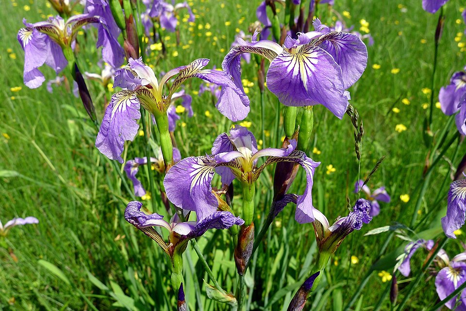
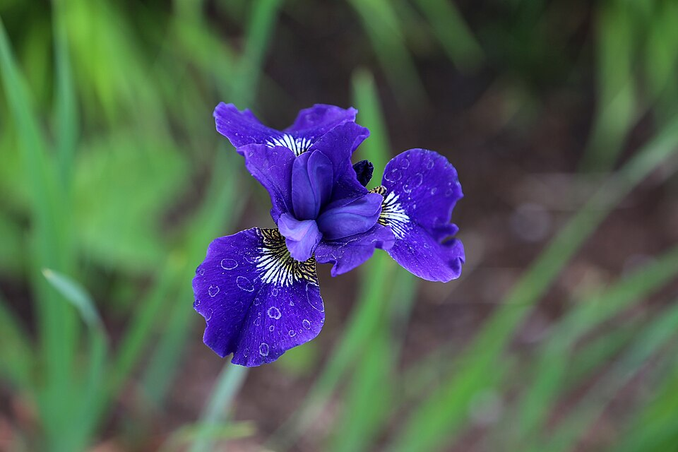
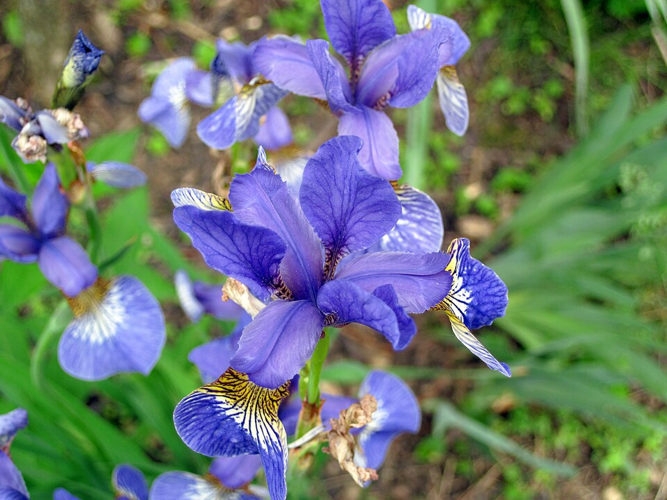

# Irysy: po czym rozpoznać gatunek

<figure markdown>

<figcaption><em>setosa</em></figcaption>
</figure>
<figure markdown>

<figcaption><em>versicolor</em></figcaption>
</figure>
<figure markdown>

<figcaption><em>virginica</em></figcaption>
</figure>

Zdjęcia z Wikimedia Commons:
<em>setosa</em> – Dr. Alexey Yakovlev, [CC BY-SA 2.0](https://creativecommons.org/licenses/by-sa/2.0/), [oryginał](https://commons.wikimedia.org/wiki/File:Iris_setosa_(Iridaceae)_(49869832502).jpg);
<em>versicolor</em> – W. Bulach, [CC BY-SA 4.0](https://creativecommons.org/licenses/by-sa/4.0/), [oryginał](https://commons.wikimedia.org/wiki/File:.00_7973_Verschiedenfarbige_Schwertlilie_(Iris_versicolor).jpg);
<em>virginica</em> – James St. John, [CC BY 2.0](https://creativecommons.org/licenses/by/2.0/), [oryginał](https://commons.wikimedia.org/wiki/File:Iris_virginica_(Virginia_iris)_(Newark,_Ohio,_USA)_13.jpg).

:material-calendar: **Wykonana:** 2 października 2026 (analiza), 20 października 2026 (artykuł i prezentacja)

Eksploracyjna analiza danych (EDA) 150 irysów trzech gatunków – praca domowa z kursu „Od zera do AI”.
Chciałem sprawdzić, które pomiary najlepiej odróżniają gatunki.

## Co zrobiłem

- sprawdziłem jakość danych: braków nie ma, są 3 zduplikowane wiersze i 4 wartości odstające – sprawdziłem,
  że nie zmieniają wyników, więc je zostawiłem,
- porównałem rozkłady czterech pomiarów w gatunkach (wykresy pudełkowe, wykresy punktowe, korelacje),
- dodałem nową kolumnę: **pole płatka** (długość × szerokość).

## Najważniejsze wnioski

1. **Wymiary płatka najlepiej odróżniają gatunki** – na wykresie punktowym tworzą trzy wyraźne grupy.
2. ***Setosa* wyraźnie różni się od pozostałych**: płatki krótsze niż 2 cm i węższe niż 0,7 cm, a przy tym najszerszy kielich.
3. ***Versicolor* i *virginica* są podobne** – różnią się głównie wielkością, a ich zakresy częściowo się nakładają.
4. **Pole płatka prawie samo rozdziela gatunki.**
5. **Korelacja na całym zbiorze może wprowadzać w błąd**: dla kielicha wyszła lekko ujemna (-0,11), a w każdym
   gatunku osobno jest dodatnia (0,46–0,75).

<a href="iris.ipynb" class="md-button md-button--primary" download>Pobierz notebook</a>
<a href="25__iris.csv" class="md-button" download>Pobierz dane (CSV)</a>

## Dodatek: te same wyniki dla odbiorcy biznesowego

Na podstawie tej analizy przygotowałem (kurs „Od zera do AI”, moduł 10) krótki artykuł i prezentację
dla osoby nietechnicznej – bez kodu, z pięcioma wykresami i jedną rekomendacją. Pokazuje, jak przekładam
analizę na decyzję.

<a href="iris_artykul.html" class="md-button md-button--primary" target="_blank">Artykuł (HTML)</a>
<a href="iris_artykul.pdf" class="md-button" target="_blank">Artykuł (PDF)</a>
<a href="iris_prezentacja.slides.html" class="md-button" target="_blank">Prezentacja</a>
<a href="iris_prezentacja.pdf" class="md-button" target="_blank">Prezentacja (PDF)</a>

## Notebook

<iframe class="notebook" src="iris.html" style="height: 1200px"></iframe>
