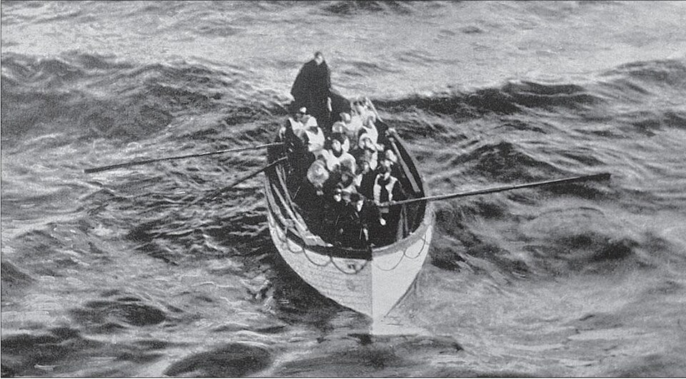

# Titanic: kto przeżył katastrofę

Szalupa nr 6 z ocalałymi, rano 15 kwietnia 1912 r. Fot. Louis Ogden, domena publiczna,
[Wikimedia Commons](https://commons.wikimedia.org/wiki/File:Titanic_lifeboat_number_6.jpeg).

:material-calendar: **Wykonana:** 2 października 2026

Eksploracyjna analiza danych (EDA) 1309 pasażerów Titanica – praca domowa z kursu „Od zera do AI”.
Chciałem sprawdzić, od czego zależała szansa na przeżycie.

## Co zrobiłem

- sprawdziłem jakość danych: pusty wiersz na końcu pliku, typy kolumn, braki (wiek nie jest znany u 263 osób,
  głównie z 3 klasy) i rzekome duplikaty nazwisk, które okazały się różnymi osobami,
- świadomie **nie uzupełniłem wieku medianą** – ok. 200 osób z 3 klasy dostałoby po 28 lat i zafałszowało wyniki,
  więc braki pokazuję jako osobną grupę,
- dodałem kolumny: wielkość rodziny na pokładzie i grupa wiekowa,
- porównałem przeżywalność według płci, klasy, wieku, portu, ceny biletu i wielkości rodziny.

## Najważniejsze wnioski

1. Przeżyło ok. **38%** pasażerów.
2. Najwięcej znaczyła **płeć**: przeżyło ok. 73% kobiet i tylko ok. 19% mężczyzn.
3. Zaraz potem **klasa**: 62% w 1 klasie, 43% w 2 i 26% w 3.
4. Dzieci miały lepsze szanse niż dorośli, ale **dzieci z 3 klasy dużo gorsze** niż z 1 i 2 (39% wobec 26 z 27).
5. **Port zaokrętowania tylko pozornie wpływał na przeżycie.** W Cherbourgu ponad połowa osób wsiadła do 1 klasy,
   w Southampton tylko co piąta – to efekt klasy, nie portu.
6. Najlepiej wypadły **małe rodziny (2–4 osoby)**; samotni pasażerowie i duże rodziny miały znacznie mniejsze szanse.

<a href="titanic.ipynb" class="md-button md-button--primary" download>Pobierz notebook</a>
<a href="26__titanic.csv" class="md-button" download>Pobierz dane (CSV)</a>

## Notebook

<iframe class="notebook" src="titanic.html" style="height: 1200px"></iframe>
