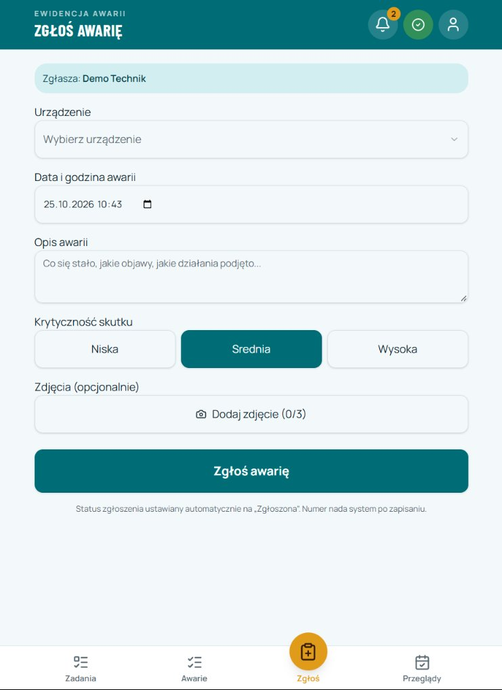
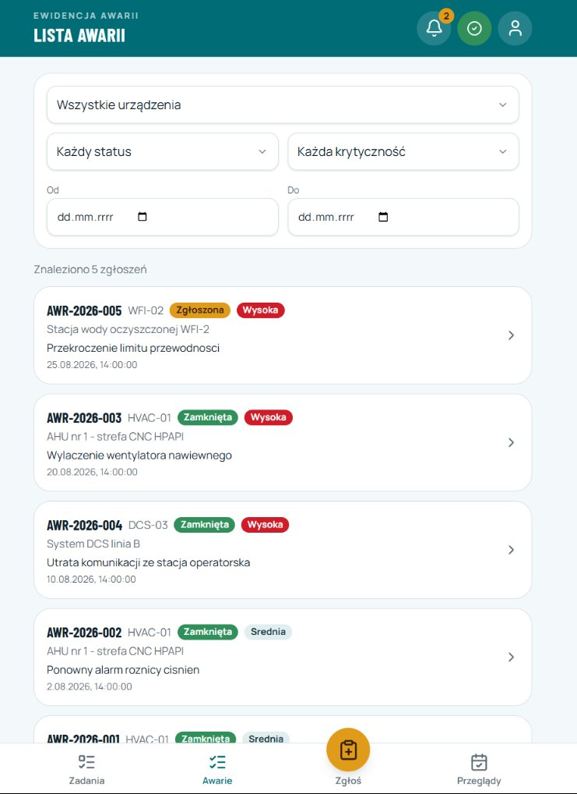
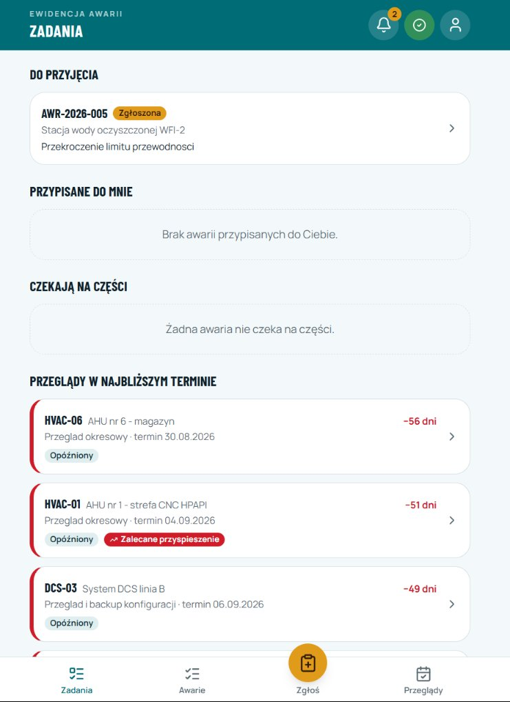

# Zgłaszanie awarii – aplikacja dla zakładu

[:material-open-in-new: aplikacja](https://zgloszenia-awarii.vercel.app) ·
[:fontawesome-brands-github: kod na GitHubie](https://github.com/Jerry-S-77/zgloszenia-awarii)

:material-calendar: **Powstała:** 4 września – 24 października 2026 (rozwijana etapami)

## Problem

W wielu zakładach awarie trafiają do arkusza Excel albo do maila. Trudno potem sprawdzić, kto się
awarią zajmuje, na jaką część czeka i które urządzenia psują się najczęściej. Na hali często nie ma też zasięgu.

## Rozwiązanie

Aplikacja na telefon (można ją dodać do ekranu głównego), w której cały obieg awarii jest w jednym miejscu:

- **zgłoszenie** w kilka sekund – wybór urządzenia z listy, opis, krytyczność, do 3 zdjęć,
- **praca offline** – zgłoszenie bez zasięgu czeka w kolejce i wysyła się samo po powrocie sieci,
- **obieg statusów** (zgłoszona → przyjęta → w naprawie → czeka na część → zamknięta) z zespołem przy awarii,
  komentarzami i pełną historią zmian,
- **przeglądy** z listami kontrolnymi i automatycznym następnym terminem; gdy urządzenie przekroczy próg
  awaryjności, baza sama proponuje przyspieszenie przeglądu,
- **części i magazyn** – pobranie części do awarii, stany minimalne, import z pliku,
- **analizy niezawodności** – MTBF i MTTR na urządzenie, Pareto przyczyn, trend miesięczny, eksport CSV,
- **powiadomienia** w aplikacji i push na telefon.

<figure markdown>

<figcaption>Zgłoszenie awarii</figcaption>
</figure>
<figure markdown>

<figcaption>Lista awarii</figcaption>
</figure>
<figure markdown>

<figcaption>Zadania technika</figcaption>
</figure>

Zrzuty ekranu z konta demonstracyjnego, dane przykładowe.

## Bezpieczeństwo i role

Cztery role: pracownik, technik, kierownik, admin. Uprawnienia egzekwuje **baza danych** (Row Level Security
w Supabase), a nie tylko interfejs. Przejścia statusów sprawdza trigger – np. zamknięcie wymaga przyczyny i czasu
przestoju. Konta zakłada wyłącznie administrator, a hasło tymczasowe trzeba zmienić przy pierwszym logowaniu.
To podejście znam z GMP: system ma pilnować reguł sam, niezależnie od tego, co pokazuje ekran.

## Jak powstała

Aplikację zaprojektowałem od strony procesu: obieg awarii, role i uprawnienia, zasady przeglądów, progi
awaryjności i wskaźniki MTBF/MTTR. To moja praktyka z utrzymania ruchu przełożona na wymagania. Rozwijałem ją
etapami i sprawdzałem działanie każdego etapu. Przy budowie korzystałem z narzędzi AI (Lovable, Claude Code).
Projekt ma testy jednostkowe, testy uprawnień na osobnej, testowej bazie i testy end-to-end na ekranie telefonu.

## Technologie

TypeScript · React (TanStack Start) · Supabase (PostgreSQL, RLS, Storage, Realtime) · Vercel ·
Vitest · Playwright · Lovable · Claude Code
